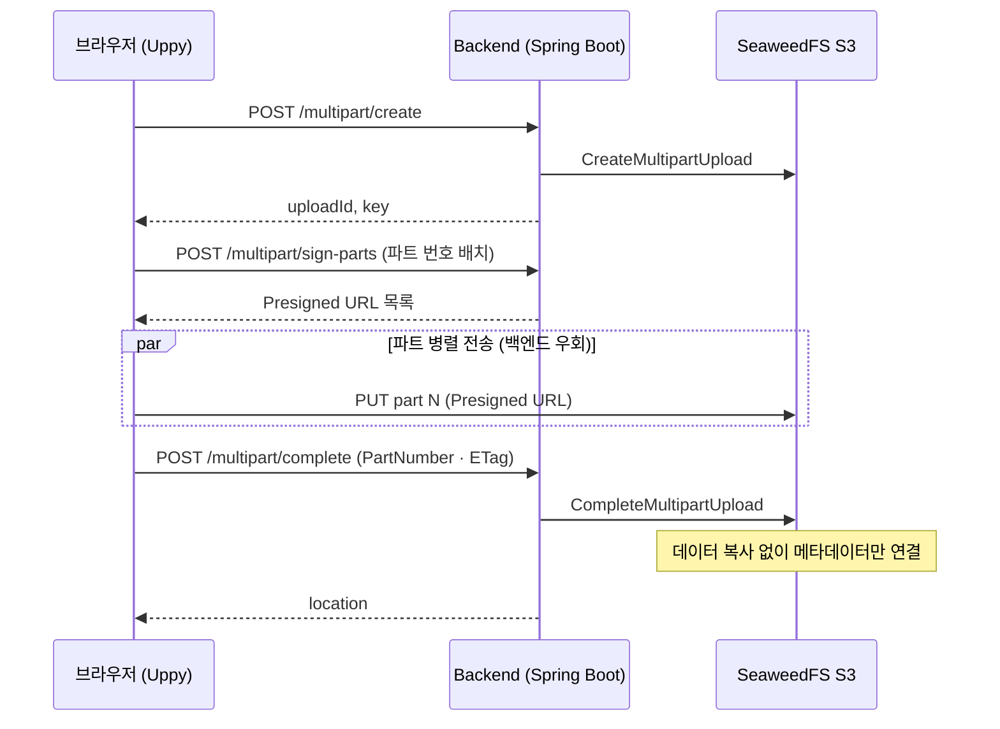

# Large Raster Upload System

10~50GB 대용량 Raster 파일(GeoTIFF 등)을 온프레미스 SeaweedFS S3로 올리는 업로드 파이프라인.
업로드 방식 5종을 같은 조건에서 실측 비교한 결과를 근거로 구조 결정.

- 상세 측정 분석 — [benchmark_results.md](benchmark_results.md)
- 블로그 — [대용량 파일 멀티파트 업로드, 정말 빠를까?](https://virtualworld.tistory.com/62)

---

## 한눈에 보기

| 항목 | 내용 |
|---|---|
| 문제 | 수십 GB 단일 파일 업로드 — 실패 시 처음부터 재전송 · 업로드 서버에 트래픽·디스크 부하 집중 |
| 핵심 결정 | Presigned URL 기반 S3 멀티파트 — 데이터는 브라우저 → 스토리지 직접 전송, 백엔드는 세션·서명만 담당 |
| 측정 결과 | 7GB 전송 약 63초(~112MB/s) — 5가지 방식 전부 1Gbps 대역폭에 수렴 → 병목은 네트워크 |
| 결론 | 멀티파트의 가치는 속도가 아닌 재시도·이어올리기·서버 부하 분리 |

---

## 아키텍처

제어 경로(세션 생성·서명·완료)와 데이터 경로(파트 전송)를 분리한 구조.



- SeaweedFS S3 호출 — path-style URL 사용 (`http://host:8333/bucket/key`)

---

## 설계 결정과 트레이드오프

### 1. 데이터 경로 — 백엔드 우회 직접 전송

- 결정 — Presigned URL로 브라우저가 SeaweedFS에 파트를 직접 PUT
- 근거 — 수십 GB 데이터가 백엔드를 거치지 않음 → 백엔드는 가벼운 제어 요청만 처리
- 대가 — 브라우저가 스토리지 엔드포인트에 직접 접근 가능해야 함 · URL 유효시간(현재 60분) 관리 필요

### 2. 업로드 상태 보관 위치 — 스토리지

- 결정 — uploadId와 업로드된 파트 목록을 SeaweedFS가 보관, 백엔드는 무상태
- 근거 — 이어올리기 시 `list-parts`로 스토리지에서 진행 상태 복원 → 백엔드 재시작·인스턴스 증설과 무관
- 비교 — 로컬 디스크 방식은 업로드 세션을 JVM 메모리(`ConcurrentHashMap`)에 보관 → 재시작 시 세션 유실 · 단일 인스턴스에 고정

### 3. 멀티파트 청킹 — 속도가 아닌 복구 단위

- 결정 — 파트 단위 전송 + 실패 파트 재시도 (재시도 간격 0·1·3·10·30초)
- 근거 — 실측상 청크 크기·동시성은 전송 속도에 영향 없음 → 이점은 실패 파트만 재전송(50GB 중 100MB) · 중단 후 재개
- 대가 — 파트 수 증가 시 요청 오버헤드 — 5MB 청크(파트 1,345개)에서 84~106MB/s로 저하

### 4. 병합 방식 — 메타데이터 연결

- 결정 — SeaweedFS `CompleteMultipartUpload`로 병합
- 근거 — 데이터 복사 없이 메타데이터만 연결 → 7GB 병합 0.04초
- 비교 — 임시 파일 순차 병합(Local-Seq)은 8~11초 + 파일 크기만큼 추가 디스크 I/O

### 5. 전송 파라미터 — 실측 수렴 구간 채택

- 청크 ≥ 16MB · 동시성 ≥ 4에서 108~111MB/s로 수렴 → UI 기본값 64MB · 동시 4를 이 구간에 배치
- 동시성 효과는 고지연(WAN) 환경에서만 의미 — LAN(RTT < 1ms)은 단일 연결로도 대역폭 포화

---

## 측정 결과

7GB 파일 · 1Gbps LAN · 동시 8 · 전송 시간과 병합 시간 분리 측정.

| 방식 | 전송 속도 | 병합 시간 | 특징 |
|------|----------|---------|------|
| S3-Multipart | ~112 MB/s | ~0초 | SeaweedFS 메타데이터만 연결 |
| Local-Offset (RAF) | ~111 MB/s | ~0초 | 청크를 offset에 직접 write |
| Local-Mmap | ~111 MB/s | ~0초 | Memory-Mapped File, OS 레벨 write |
| Local-Stream | ~113 MB/s | ~0초 | 청킹 없는 단일 스트림, 가장 단순 |
| Local-Seq (temp+merge) | ~111 MB/s | **~10초** | 임시파일 저장 후 순차 병합 |

- 전송 속도 110~113MB/s로 동일 — 이론치 125MB/s의 88% → 병목은 네트워크
- 디스크는 여유 — 순차 읽기 1,324MB/s · 순차 쓰기 567MB/s (`winsat` 실측)
- 속도 향상 수단은 1G → 10G 네트워크 전환뿐 — 10Gbps에서는 디스크 읽기가 새 병목으로 전환

| 상황 | 추천 방식 |
|------|---------|
| 실무 (재시도·이어올리기 필요) | **S3-Multipart** |
| 서버와 스토리지가 LAN 연결, 병렬 불필요 | Local-Stream |
| 로컬 저장 + 병렬 청크 | Local-Offset |
| 임시파일 방식 | Local-Seq — 비권장 (병합 +10초) |

---

## 한계와 개선 방향

- WAN 환경 미검증 — `tc qdisc`는 송신(egress)만 제어, ingress police는 패킷 드롭 방식 → TCP 재전송 폭증으로 결과 왜곡 → 실제 WAN 측정 필요
- 미완료 업로드 정리 없음 — abort 없이 이탈한 업로드의 잔여 파트가 스토리지에 남음 → 만료 기반 정리 정책 필요
- 업로드 후처리 미연결 — 완료 이벤트(SeaweedFS Filer Notification)로 후처리 파이프라인을 트리거하는 구조는 설계 단계 ([API 명세](backend-api-spec.md))
- 전송량 자체 축소 — GeoTIFF는 내부 압축 → 압축 전송 효과 제한적 · 중복 제거(CDC)·델타 전송이 검토 대상

---

## 빠른 시작

### 사전 요구사항
- Java 17+
- SeaweedFS (`weed server -s3`)
- Live Server (VS Code 확장) 또는 아무 HTTP 서버

### 1. 백엔드 설정

`backend/src/main/resources/application.yml` 수정:

```yaml
seaweedfs:
  s3:
    endpoint: http://<SeaweedFS-IP>:8333
    access-key: <your-access-key>
    secret-key: <your-secret-key>
    bucket: <your-bucket-name>

cors:
  allowed-origins:
    - http://localhost:5500
    - http://127.0.0.1:5500
```

### 2. 백엔드 실행

```bash
cd backend
./gradlew bootRun
# 또는 jar로 실행
./gradlew bootJar
java -jar build/libs/big-size-uploader-1.0.0.jar
```

서버 기본 포트: **8080**

### 3. 프론트엔드 실행

`uploader.js` 상단의 `BACKEND_URL` 확인 (기본값: `http://localhost:8080`):

```js
const BACKEND_URL = 'http://localhost:8080/api/upload';
```

`index.html`을 Live Server로 열거나:
```bash
npx serve .   # Node.js 있는 경우
```

브라우저에서 `http://localhost:5500` 접속

---

## 벤치마크

Node.js 18+ 필요

```bash
# S3 멀티파트만
node benchmark.mjs s3

# 로컬 디스크 방식만 (offset/seq/stream/mmap)
node benchmark.mjs local
node benchmark.mjs local-seq
node benchmark.mjs local-stream
node benchmark.mjs local-mmap

# 전체 비교
node benchmark.mjs both
```

`benchmark.mjs` 상단에서 파일 경로 및 파라미터 설정:

```js
const FILE_PATH      = '/path/to/your/large-file.tif';
const BASE_URL       = 'http://<server-ip>:8080';
const CHUNK_SIZES_MB = [32, 64, 100];
const CONCURRENCIES  = [1, 2, 4, 8];
```

결과는 `benchmark_results_<날짜>.csv`로 저장됩니다 (Excel BOM 포함).

---

## API 엔드포인트

### S3 멀티파트 (Presigned URL)
| Method | Path | 설명 |
|--------|------|------|
| POST | `/api/upload/multipart/create` | 업로드 세션 시작 |
| POST | `/api/upload/multipart/sign-parts` | Presigned URL 배치 발급 |
| POST | `/api/upload/multipart/complete` | 병합 완료 |
| POST | `/api/upload/multipart/abort` | 업로드 중단 |
| GET  | `/api/upload/multipart/list-parts` | 업로드된 파트 목록 |

### 로컬 디스크 (벤치마크용)
| Method | Path | 방식 |
|--------|------|------|
| POST | `/api/local/upload/*` | Offset (RandomAccessFile) |
| POST | `/api/local/upload-seq/*` | Sequential (temp + merge) |
| POST | `/api/local/upload-stream/*` | Single stream |
| POST | `/api/local/upload-mmap/*` | Memory-Mapped File |

---

## 프로젝트 구조

```
large_data_uploader/
├── index.html          # 업로드 UI
├── uploader.js         # Uppy 기반 S3 멀티파트 클라이언트
├── benchmark.mjs       # 성능 측정 스크립트 (Node.js)
└── backend/            # Spring Boot 백엔드
    └── src/main/
        ├── java/.../
        │   ├── controller/   # MultipartUpload + LocalUpload 컨트롤러
        │   ├── service/      # 업로드 로직
        │   ├── config/       # S3Config, CorsConfig
        │   └── dto/          # 요청/응답 DTO
        └── resources/
            └── application.yml
```
